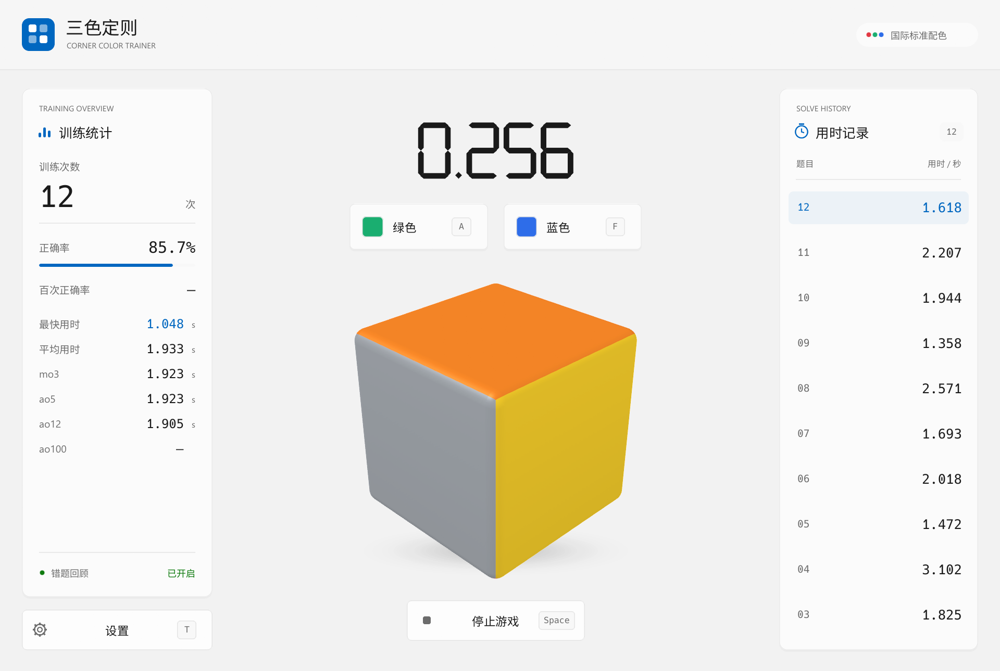
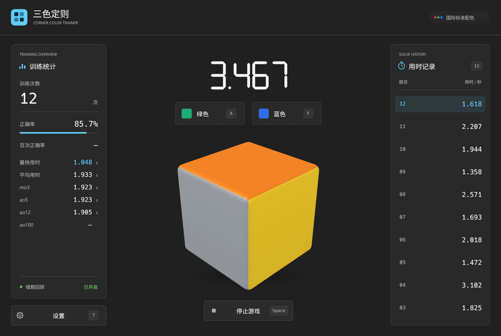
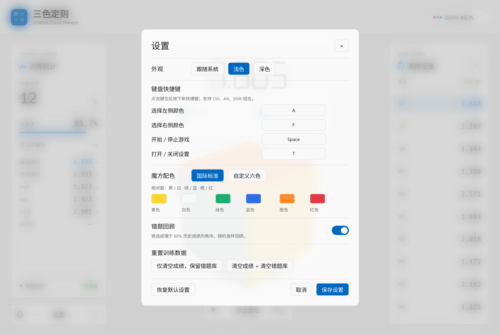

# 三色定则 · Corner Trainer

一款三阶魔方角块配色识别训练工具。观察角块上两个已知面的颜色与位置，从两个候选颜色中选出第三面的颜色，练习三色定则与空间判断。

Rust 原生桌面应用，支持 Windows 10 / 11。内置中文字体，解压即可运行，训练过程可完全离线使用。

**[下载 Windows 版](https://github.com/PrimeX-06/corner-trainer/releases/latest) · [开始训练](#开始训练) · [从源码构建](#从源码构建)**



## 功能

- **角块识色训练**：覆盖八种角块的二十四种合法可见朝向，遵循真实魔方的配色与旋转关系。
- **固定底色练习**：任选一种或多种底面颜色，集中练习特定朝向。
- **错题与慢题回顾**：自动记录易错、耗时较长的角块，提高后续训练中的出现频率。
- **成绩统计**：七段数码计时器、正确率、百次正确率、最快与平均用时，以及 mo3、ao5、ao12、ao100。
- **外观与交互**：浅色、深色、跟随系统主题；彩色塑料角块、柔和光照、设置弹窗模糊与过渡动画。
- **个性化设置**：自定义六色配色、键盘快捷键与组合键，支持鼠标答题。
- **自动保存**：成绩、回顾记录和设置保存在本机，关闭应用后可继续训练。

## 下载与运行

1. 打开 [Releases](https://github.com/PrimeX-06/corner-trainer/releases/latest)，下载 `CornerTrainer-win64.zip`。
2. 解压压缩包，双击 `CornerTrainer.exe`。
3. 按 `Space` 或点击“开始游戏”进入训练。

发布包面向 **Windows 10 / 11 64 位系统**，无需安装 Rust。窗口最小尺寸为 1100 × 740，建议在能容纳该窗口的屏幕上使用。

## 开始训练

每题展示角块的三个面，其中一个面以灰色遮住。根据另外两面的颜色与展示位置，判断灰色面应有的颜色，然后点击对应按钮或按快捷键作答。

答对后，本题累计用时写入成绩，并立即进入下一题。答错时，所选按钮上方显示红色叉号，当前题目继续计时，直到答对。停止游戏会舍弃尚未完成的题目。

### 默认快捷键

| 按键 | 操作 |
| --- | --- |
| `A` | 选择左侧候选颜色 |
| `F` | 选择右侧候选颜色 |
| `Space` | 开始 / 停止游戏 |
| `T` | 打开 / 关闭设置 |
| `Esc` | 关闭设置；录入快捷键时取消录入；关闭底色菜单 |

候选颜色固定按 **黄 / 白、绿 / 蓝、橙 / 红** 配对，每组前一种位于左侧，后一种位于右侧。

在设置中点击键位按钮，再按下新的按键即可修改快捷键，支持 `Ctrl`、`Alt`、`Shift` 组合。打开设置期间，进行中的题目继续计时。

### 固定底色

游戏开始前，将鼠标悬停在“开始游戏”按钮上，可展开“固定底色”菜单。

- 默认选中全部六种底色，可勾选一种或多种，至少保留一种。
- 底色表示完整魔方的底面颜色。例如选中白色底面时，展示的上面对应黄色。
- 只选一种底色时，随机遮住两个侧面之一；选择多种底色时，上面与两个侧面均可被遮住。
- 选择自动保存。关闭错题回顾后，各种已选底色的抽中概率相同。

### 配色与角块朝向

标准配色采用 **白上、黄下、绿前、蓝后、红右、橙左**。三组相对面为黄 / 白、绿 / 蓝、橙 / 红。

八种角块各有三种合法可见朝向，共二十四种。同一对已知颜色及其展示位置，对应唯一的正确答案。

自定义六色会替换各面的显示颜色，保留相对面的关系与合法朝向。六种颜色需要互相可区分，候选按钮沿用原有配对位置。

开始游戏前，六色立方体会自动旋转。按住鼠标左键拖动可调整朝向；停止拖动 1.5 秒后恢复自动旋转。答题期间角块保持稳定。

## 成绩与回顾

### 统计指标

| 指标 | 计算方式 |
| --- | --- |
| 训练次数 | 已完成的题目数 |
| 正确率 | 已完成题数 ÷（已完成题数 + 累计错选次数），重复错选也计入 |
| 百次正确率 | 最近 100 道已完成题中，首次作答即答对的比例 |
| 最快用时 | 已完成题目的最短用时 |
| 平均用时 | 全部已完成题目的算术平均用时 |
| mo3 | 最近 3 题的算术平均，保留全部 3 题 |
| ao5 / ao12 | 最近 5 / 12 题，分别去掉最快与最慢各 1 题，再求平均 |
| ao100 | 最近 100 题，去掉最快与最慢各 5 题，再求平均 |

每题用时包含从出题到最终答对的全部时间。计时使用单调时钟，数据保留微秒，界面显示到 `0.001` 秒。相应题数不足时，统计项显示 `—`。右侧用时记录按完成顺序倒序排列，最新成绩位于顶部。

### 错题与慢题

回顾记录按角块的三色组合保存。错选会增加该角块的回顾权重；新题用时超过此前成绩的第 80 百分位时，该角块也会进入慢题回顾。

开启回顾后，权重较高的角块更容易出现，同一角块可换朝向再次练习。关闭回顾后，符合底色选择的合法朝向等概率抽取，错选与慢题记录仍持续保存。

<details>
<summary>回顾权重的计算规则</summary>

- 错选奖励为 `3 × min(累计错选次数, 12)`。
- 慢题阈值取本题完成前全部已完成成绩的第 80 百分位。第一题用于建立基线。
- 本题严格超过阈值时，慢题奖励为 `ceil(36 × (本题用时 / 阈值 − 1))`，最高为 36；同一角块保留历史最高慢题奖励。用时达到阈值两倍时达到上限。
- 每个合法朝向的抽取权重为 `1 + min(错选奖励 + 慢题奖励, 36)`，单个角块最高权重为 37。
- 开启回顾后，连续出题排除上一题的相同朝向；只选一种底色时，相邻题目使用不同角块。
- 仅清空成绩会保留错选与慢题回顾记录；同时清空错题库会删除两类回顾记录。

</details>

## 外观与设置

默认跟随 Windows 的浅色 / 深色模式，也可手动选择主题。Windows 11 支持系统云母窗口背景；系统材质不可用时，使用对应主题的背景色。

主题选择会立即预览，点击“保存设置”后保留。点击“取消”、关闭按钮，或按 `T` / `Esc` 关闭设置，会恢复已保存的主题；重新绑定设置快捷键后，使用对应的新键位。

| 深色训练界面 | 设置界面 |
| --- | --- |
|  |  |

截图中的成绩为演示数据。

## 数据保存

Windows 上的数据文件位于：

```text
%LOCALAPPDATA%\CornerTrainer\data\data.json
```

该文件包含成绩、错选与慢题回顾记录、底色选择、配色、主题和快捷键。备份此文件即可保留训练数据，恢复前请先关闭应用。

数据文件无法解析时，应用会在同一目录备份原文件。旧版本数据会自动迁移，保留成绩与已自定义的快捷键；旧默认键位 `1 / 2 / Space / S` 会更新为 `A / F / Space / T`。

## 从源码构建

Windows 开发环境需要：

- [Rust stable](https://rustup.rs/)，使用 MSVC 工具链。
- [Visual Studio Build Tools](https://visualstudio.microsoft.com/visual-cpp-build-tools/)，安装“使用 C++ 的桌面开发”和 Windows SDK。
- Git。

```powershell
git clone https://github.com/PrimeX-06/corner-trainer.git
cd corner-trainer
cargo run --release --locked
```

首次构建需要联网下载依赖。单独构建发布程序：

```powershell
cargo build --release --locked
```

可执行文件生成在 `target/release/cube-trainer.exe`。发布包中的程序命名为 `CornerTrainer.exe`。

### 检查与测试

```powershell
cargo fmt --check
cargo test --locked
cargo clippy --locked --all-targets --all-features -- -D warnings
```

应用内的截图与输入检查使用独立的 `qa/` 数据目录，完成后自动关闭：

```powershell
cargo run --locked --features qa -- --qa
```

可单独检查设置动画或底色菜单：

```powershell
cargo run --locked --features qa -- --qa --qa-settings-animation
cargo run --locked --features qa -- --qa --qa-bottom-colors
```

### 源码结构

| 文件 / 目录 | 内容 |
| --- | --- |
| `src/model.rs` | 魔方规则、出题、计时、成绩统计、配置与持久化 |
| `src/cube.rs` | 角块与立方体的透视、光照、渲染和旋转 |
| `src/app.rs` | 三栏界面、答题交互、设置与应用检查 |
| `src/ui.rs` | 基础界面控件 |
| `src/digits.rs` | 七段数码计时器 |
| `src/theme.rs` | 浅色 / 深色样式与主题配置 |
| `src/native.rs` | Windows 系统主题与窗口背景材质 |
| `src/main.rs` | 桌面应用入口 |
| `build.rs` | Windows 图标与程序资源 |
| `assets/` | 应用图标、内置中文字体及字体许可 |

## 反馈与许可

欢迎通过 [Issues](https://github.com/PrimeX-06/corner-trainer/issues) 提交问题与建议。报告问题时，请附上应用版本、Windows 版本和复现步骤。

应用源码采用 [MIT License](LICENSE)。内置 Noto Sans CJK 字体采用 [SIL Open Font License 1.1](assets/FONT-LICENSE.txt)。
